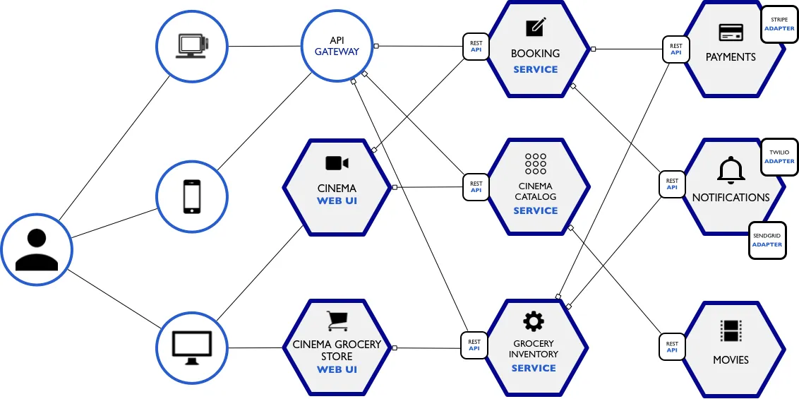

<h1>
  Intro to Microservices Architecture
  What is a Microservices Architecture?
</h1>

**Learning objective:** By the end of this lesson, learners will be able to explain the key characteristics of microservices architecture, identify its benefits and drawbacks, and describe how microservices operate independently while remaining loosely coupled in a distributed system.

## What is a Microservices Architecture?

**[Adrian Cockroft](https://g.co/kgs/YQmtE9K)**, a key engineer behind Netflix’s shift from a monolithic to a microservices architecture, describes it as "a service-oriented architecture composed of loosely coupled elements that have bounded contexts."

The term "loosely coupled" is crucial here. It means that each service operates independently, allowing for updates without affecting other services. If you find yourself needing to update multiple services simultaneously, they likely lack the necessary decoupling to qualify as true microservices.

One common pitfall during this transition is database coupling, where multiple services rely on a single database. This can lead to complications, such as needing to change the database schema when updating a service. To avoid this, it's essential to separate databases for different services and embrace a denormalized approach. This separation not only enhances service independence but also streamlines updates and maintenance.

Hear more from the experts:

<blockquote class="quote">
  A microservice is a single self-contained unit which, together with many others, makes up a large application. By splitting your app into small units every part of it is independently deployable and scalable, can be written by different teams and in different programming languages and can be tested individually.
   Max Stoiber
</blockquote>

<blockquote class="quote">
  A microservice architecture means that your app is made up of lots of smaller, independent applications capable of running in their own memory space and scaling independently from each other across potentially many separate machines.
   Eric Elliot
</blockquote>

 

  <h2 class="title">What are the benefits of microservices?</h2>
  10

Let's discuss some of the benefits of using this style of architecture:

| **Benefits**                                      | **How?**                                                                                                                                                  |
| ------------------------------------------------- | ------------------------------------------------------------------------------------------------------------------------------------------------------------ |
| **Faster application startup times**              | Microservices allow applications to start up more quickly since each service is smaller and starts independently.                                            |
| **Quicker and more efficient deployments**        | Deployments are faster and more streamlined because individual services can be deployed separately without affecting the entire system.                      |
| **Independent service deployment**                | Each microservice can be deployed on its own, allowing for frequent updates and new versions without downtime for other services.                            |
| **Easier to scale and improve performance**       | Microservices can be scaled individually, allowing teams to allocate more resources to specific services, leading to better overall performance.             |
| **No long-term commitment to a technology stack** | Each new microservice can be built using different technologies, providing flexibility to choose the best stack for the task.                                |
| **More organized and focused services**           | Microservices are typically more organized, as each one focuses on a specific job, making the architecture easier to manage.                                 |
| **Greater flexibility for reconfiguration**       | Decoupled microservices can be reconfigured for different applications, such as serving both web clients and public APIs, without impacting the core system. |

 

  <h2 class="title">What are the drawbacks of microservices?</h2>
  10

Let's discuss some of the challenges that come with using a microservices architecture:

| **Challenges**                                  | **How?**                                                                                                                                      |
| ----------------------------------------------- | ------------------------------------------------------------------------------------------------------------------------------------------------ |
| **Developers must manage increased complexity** | Microservices add complexity, as developers must manage a distributed system with multiple services communicating across networks.               |
| **Operational complexity in production**        | Managing and deploying a large number of services in production can be more complex, requiring sophisticated monitoring and orchestration tools. |
| **Unforeseen cross-cutting concerns**           | During implementation, teams may encounter issues like security, logging, or data consistency that weren’t anticipated during the design phase.  |

 
